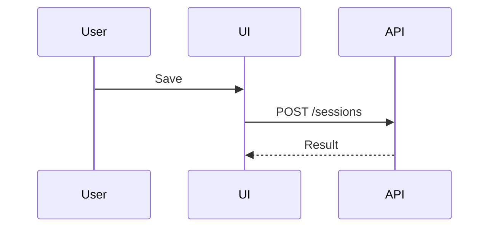

# 视觉表达

先确定读者需要看清什么。一句话能说清时直接用文字。需要图示时，只保留回答这个问题所需的元素。

| 读者的问题                       | 表达形式                                                                           |
|----------------------------------|------------------------------------------------------------------------------------|
| 哪个条件会改变执行路径或状态？   | 用伪代码标出条件和对应结果。                                                       |
| 谁包含谁？                       | 用文本树表示层级和组成。                                                           |
| 谁先调用谁，结果返回给谁？       | 用 Mermaid 时序图标出参与者和消息顺序。                                            |
| 代码或方案具体改了哪一步？       | 用 diff 展示变化，保留能定位改动的上下文。                                         |
| 页面如何呈现，操作后发生了什么？ | 运行真实应用验证布局、样式和交互。静态外观可用截图，交互变化可展示操作前后的状态。 |

按代码、配置、日志或测试结果核对图中的关系。说明哪项观察支持结论。真实应用不可用时，可以用独立原型或生成图片说明预期效果，并标明真实应用中仍待验证的部分。命令、代码和其他需要复制的内容使用纯文本。

## 示例

**保存时何时复用缓存？**

```text
on(save)
  if unchanged: return cached result
```

**会话页面包含哪些组件？**

```text
SessionPage
├── Toolbar
└── Timeline
```

**点击保存后，谁发起请求？**



**提交表单时新增了哪一步？**

```diff
 submitForm
+  expandSkillMention
   launchAgent
```
