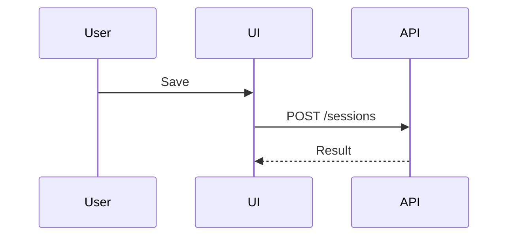

# Visual explanation

Decide what the reader needs to see first. If one sentence makes it clear, use text. When a visual helps, keep only the elements needed to answer that question.

| Reader's question | Visual form |
| --- | --- |
| Which condition changes the execution path or state? | Use pseudocode to show conditions and outcomes. |
| What contains what? | Use a text tree for hierarchy and composition. |
| Who calls whom first, and where does the result return? | Use a Mermaid sequence diagram for participants and message order. |
| How do states transition, or how does data flow across components? | Use a Mermaid state diagram or flowchart. |
| How do options, configurations, or cases compare across attributes? | Use a Markdown table with parallel columns. |
| Which step changed in the code or design? | Use a diff with enough context to locate the change. |
| How does the UI look, and what changes after an action? | Run the real app to verify layout, styling, and interaction. Use a screenshot for static appearance and before/after states for interaction changes. |

For current system behavior, verify relationships in the visual against code, configuration, logs, or test results, and cite the supporting observation. For proposed or unimplemented designs, label planned elements explicitly instead of presenting them as current behavior.

When the output medium does not render Mermaid (such as a plain terminal), prefer compact text trees, pseudocode, Markdown tables, or simple ASCII flows. When the real app is unavailable for UI explanations, prefer a minimal HTML/SVG prototype or text wireframe over a generated image. Reserve generated images for visual concepts, and mark what still needs verification in the real app. Keep commands, code, and other copyable content as plain text.

## Examples

**When does save reuse the cache?**

```text
on(save)
  if unchanged: return cached result
```

**Which components make up the session page?**

```text
SessionPage
├── Toolbar
└── Timeline
```

**Who sends the request after clicking Save?**



**Which step was added to form submission?**

```diff
 submitForm
+  expandSkillMention
   launchAgent
```
