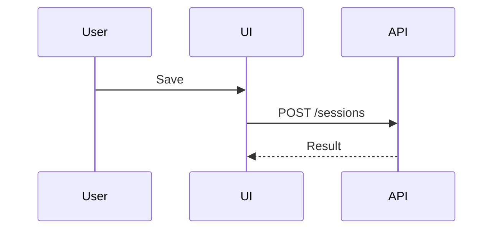

# Visual explanation examples

Choose the example that matches the reader's question and adapt it to the system you are explaining.

**When does save reuse the cache?** (pseudocode for a condition)

```text
on(save)
  if unchanged: return cached result
```

**Which components make up the session page?** (text tree for composition)

```text
SessionPage
├── Toolbar
└── Timeline
```

**Who sends the request after clicking Save?** (sequence diagram for message order)



**Which step was added to form submission?** (diff located in the changed function)

```diff
 submitForm
+  expandSkillMention
   launchAgent
```
